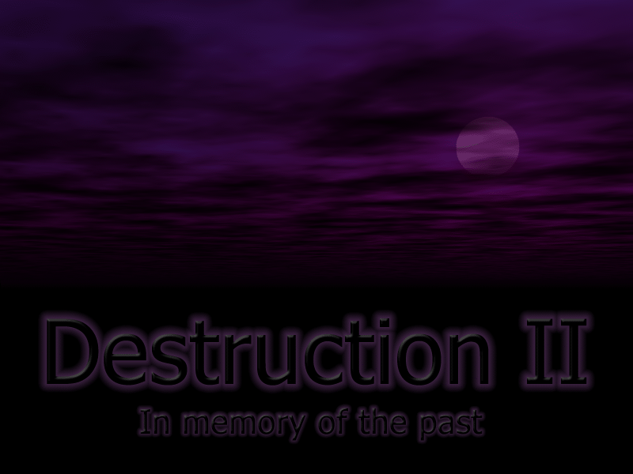
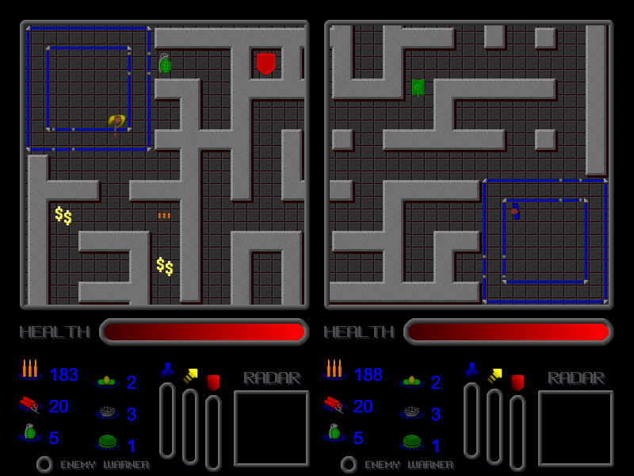
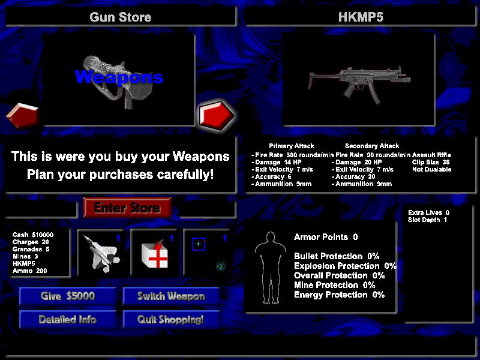

# Destruction II — Reborn

<p align="center">
  
</p>

**Destruction II** (Johan Torp / Nocturnal Development, 2001–2003) is a two-player split-screen
action game: shoot your way through destructible mazes, survive tanks, droids and air strikes, and
spend your loot in the shop between rounds.

This repository brings it back to life in the web browser: the **original C++ source compiled to
WebAssembly**, playing the same as the 2003 Windows release. It also keeps the original game files
the port was built from.

<p align="center">
  
  
</p>

## Play in 30 seconds

You need Python 3 (preinstalled on macOS and most Linux systems) and a modern browser.

```sh
cd web/dist
python3 -m http.server 8642
```

Open **http://127.0.0.1:8642/** and click **Click to play**.

| | Left player | Right player |
|---|---|---|
| Move | E / S / D / F | Arrow keys |
| Fire | Left Ctrl | Enter |
| Menus | Arrow keys + Enter, Esc = back | |
| Save game | F10 on the *Get Ready* screen | |
| Quit | F12 | |

Players, saved games and settings are stored in your browser. Gamepads work too.
To put the game on a website, upload the four files in `web/dist/` to any static host
(for example GitHub Pages).

## What's in this repository

```
├── web/          The web port: play it and rebuild it (start here)
├── original/     The original files, exactly as they were distributed
└── extracted/    Contents unpacked from the original files, used to make the port
```

| Folder / file | What it is |
|---|---|
| [`web/`](web/) | **The web port** — see [`web/README.md`](web/README.md) for build instructions and technical details |
| `web/dist/` | Ready-to-play build (`index.html`, `d2.js`, `d2.wasm`, `d2.data`) |
| `web/src/` | The original game source code, with small fixes so it compiles with a modern compiler |
| `web/compat/` | The replacement for Windows/DirectX that lets the game run in a browser |
| `web/assets/` | Game graphics, sounds and default settings used by the build |
| `web/shell/` | The web page around the game (screen, keyboard, sound, saving) |
| `web/docs/` | Screenshots |
| `web/tools/` | Helper scripts: resource extractor, code fixers, browser test driver, reverse-engineering helpers |
| `original/destruction2/d2free.exe` | The original Destruction II Windows installer (free version) |
| `original/destruction2/destructionII_source_and_resources_complete-1.00.zip` | The original source code and resources release |
| `original/destruction2/Game01.gif` | Original screenshot from the 2003 distribution |
| `original/destruction1/destruction.zip` | **Destruction I** (2001), the predecessor game for Windows |
| `extracted/installer/` | `d2free.exe` unpacked: the original Windows game (`app/D2.exe`), sounds, data and documentation |
| `extracted/source/` | The source zip unpacked: original `Code/`, `Bitmaps/` and `RunDir/` |
| `extracted/bitmaps/` | The 87 bitmaps extracted from `D2.exe` (the source release did not include them by name) |

To play the original on Windows instead, run `original/destruction2/d2free.exe`
(or `extracted/installer/app/D2.exe`).

## How it was made

The game's source was compiled with Emscripten. Its Windows graphics (DirectDraw), sound
(DirectSound), input (DirectInput) and text drawing (GDI) are emulated by a small layer written
for this project. Details that matter for gameplay, like the original's timing loop, palette
colour-matching and file formats, were reproduced and checked against the original `D2.exe` by
decompiling it. Full details: [`web/README.md`](web/README.md).

## License

This repository contains two kinds of material with different owners:

- **The web port** — `web/compat/`, `web/shell/`, `web/tools/`, `web/build.sh` and the README
  files — is released under the [MIT License](LICENSE). You may use, change and share it,
  but you must keep the copyright notice and license text, crediting this project.
- **Destruction II itself** — the original source code (`web/src/`, `extracted/source/`), graphics,
  sounds, installers and executables (`original/`, `extracted/`) — is © Johan Torp /
  Nocturnal Development 2001–2003, all rights reserved. It is **not** covered by the MIT License. The original notice allows the installation
  archive to be shared unaltered; any other use requires the author's permission.

This is an unofficial fan project, not affiliated with or endorsed by Nocturnal Development.

## Credits

- **Destruction II** — code, graphics and sound by Johan Torp, Nocturnal Development.
- **Web port** — `Suleiman700`.
