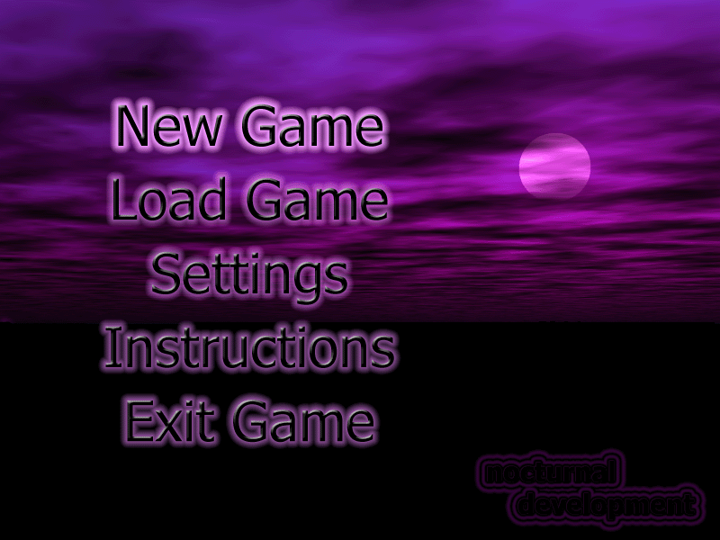
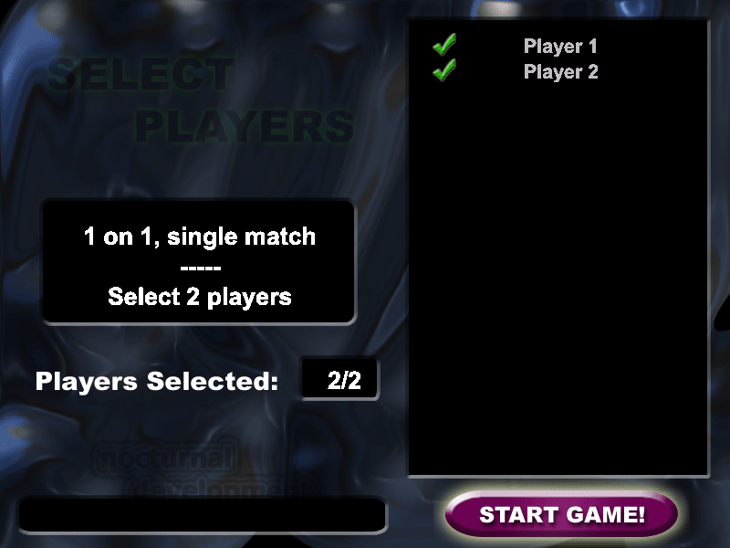
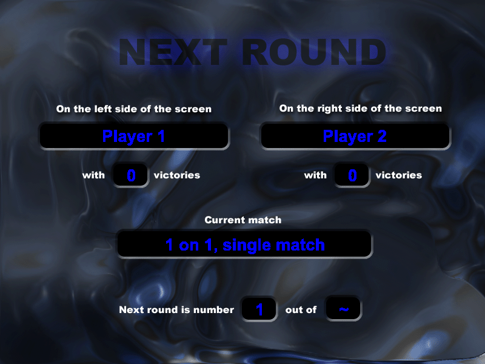
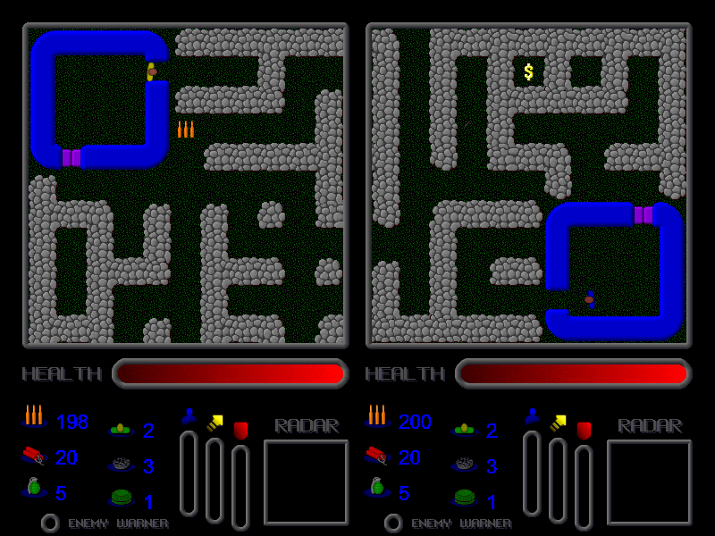
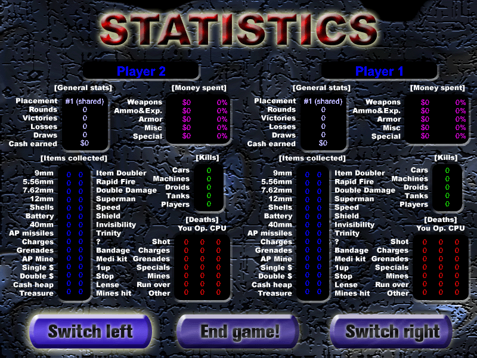
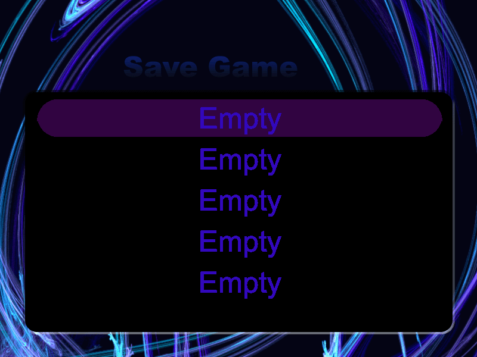
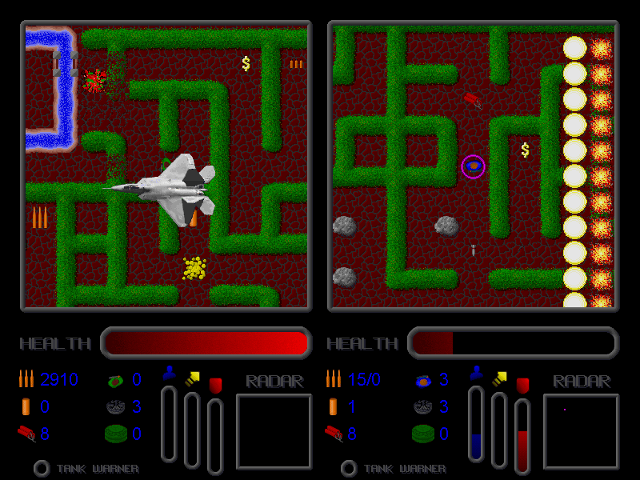

# Destruction II — WebAssembly port

<p align="center">
  
</p>

**Destruction II** (Johan Torp / Nocturnal Development, 2001–2003) is a two-player split-screen
action game: shoot your way through destructible mazes, dodge tanks, droids and air strikes, and
spend your loot in the shop between rounds.

This repository runs the **original C++ source in the browser**, compiled to WebAssembly with
Emscripten. The game code is left as it was (apart from a handful of MSVC 6 dialect fixes); Windows,
DirectDraw, DirectSound and DirectInput are emulated by a small compatibility layer, so it plays the
same as the 2003 release.

## Screenshots

| | |
|:---:|:---:|
|  |  |
| Main menu | Player selection |
|  |  |
| Round setup | The shop |
|  |  |
| Split-screen gameplay | Leaving the bases |
|  |  |
| End-of-game statistics | Save / load |

The original game, for comparison (screenshot from the 2003 distribution):

<p align="center">
  
</p>

## Play

The game must be served over HTTP (browsers block WebAssembly from `file://`):

```sh
cd dist
python3 -m http.server 8642
# open http://127.0.0.1:8642/
```

Click **Click to play** (browsers need a click before they allow sound).

| | Left player | Right player |
|---|---|---|
| Move | E / S / D / F | Arrow keys |
| Fire | Left Ctrl | Enter |
| Menus | Arrow keys + Enter, Esc = back | |
| Save game | F10 on the *Get Ready* screen | |
| Quit | F12 | |

Keys can be changed in the in-game Controls menu. Players, saved games, controls and settings are
stored in the browser (IndexedDB). Gamepads are supported through the Gamepad API — press a button on
the pad before opening the Controls menu so the browser exposes it.

To host it, publish the contents of `dist/` on any static web host (for GitHub Pages, push `dist/`
to a `gh-pages` branch).

## Build

Requires the [Emscripten SDK](https://emscripten.org/docs/getting_started/downloads.html)
(`$EMSDK`, or `~/emsdk` by default).

```sh
./build.sh          # release build  -> dist/
./build.sh debug    # assertions + SAFE_HEAP -> dist-debug/
```

Append `?debug` to the page URL to log focus, keyboard and input-poll events to the console.

## How it works

| Path | Contents |
|---|---|
| `src/` | The original game source |
| `compat/` | Win32 / DirectX 7 headers and the web runtime (`runtime.cpp`), plus clean-room replacements for the DirectX SDK helpers `ddutil` and `wavread` |
| `assets/Bitmaps/` | The 87 bitmap resources, extracted from the shipped `D2.exe` (the source release has no resource script) with `tools/extract_res.py` |
| `assets/Sound/`, `assets/Data/` | Sounds and default configuration from the original installer |
| `shell/index.html` | Web page: canvas, keyboard mapping, Web Audio output, persistent storage |
| `tools/` | Porting helpers (resource extractor, MSVC for-scope scanner/fixer) and a dependency-free Chrome DevTools test driver |

The runtime emulates what the game relies on, as closely as possible:

- **Graphics** — 800×600, 8-bit palettized DirectDraw surfaces with a flipping primary surface,
  colour-keyed blits and palette fades. Bitmaps are colour-matched to the active palette the way GDI
  did on an 8-bit display (the artwork uses about 40 different palettes). Blits reject out-of-bounds
  rectangles exactly like DirectDraw without a clipper.
- **Text and shapes** — a software GDI (fonts, pens, brushes, rectangles, rounded rectangles,
  lines); text is rasterised by the browser and thresholded, since Windows never antialiased text on
  8-bit screens.
- **Timing** — while waiting for vertical blank the original keeps running game logic in a busy
  loop, about one step per millisecond. The runtime reproduces that inside each browser frame.
- **Sound** — DirectSound streaming buffers with play cursors and DirectSound's volume/pan curves,
  mixed in software and played through Web Audio.
- **Input** — DirectInput keyboard state from browser key events (taps shorter than one poll are not
  lost), joysticks from the Gamepad API.
- **Files** — Windows paths, case-insensitive names and MSVC text-mode reads (CRLF, Ctrl-Z) on top
  of an IndexedDB-backed file system.

### Checked against the original executable

Parts of the behaviour were verified by decompiling the shipped `D2.exe` (Ghidra, via the REA
reverse-engineering toolkit):

- The release was built with copy protection and run with the free license that came with it, i.e.
  as a registered copy. This port builds without the protection code and mirrors the two visible
  registered behaviours: unlimited rounds by default, and *Exit* quits directly.
- `LoadBitmap(&surface, name)` in two places compiled to the Win32 `LoadBitmapA` call with an invalid
  handle, so in the original it never did anything. The port keeps it a no-op.
- `Game::LoadBitmapToSurface` decompiles to the same code as the source, confirming the source
  matches the released build.

### Known differences

- Glyph shapes can differ by a pixel from Windows' hinted fonts (font metrics follow GDI).
- The original's logic ran as fast as the PC allowed, so a few per-step random events (e.g. how often
  UFOs appear) depended on the machine; the port runs at roughly the rate of a modern PC.
- Some browser shortcuts (Cmd/Ctrl+W and similar) cannot be captured.

### Bugs in the original made harmless

All of these only matter when the game shuts down: a double delete in the shop's destructor,
`~Game` touching already-released objects when quitting mid-round (on Windows the process was ending
at that point anyway), and a `DeleteObject` call one element past the end of an array, which Win32
silently ignored.

## Credits and license

Destruction II — code, graphics and sound by **Johan Torp**, © Nocturnal Development 2001–2003.
All rights to the game, its source code and its assets belong to the author.

The web port (`compat/`, `shell/`, `tools/`, `build.sh`) is released under the MIT License — see
[`../LICENSE`](../LICENSE). It is a fan project, not affiliated with or endorsed by Nocturnal
Development.
